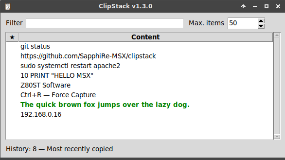
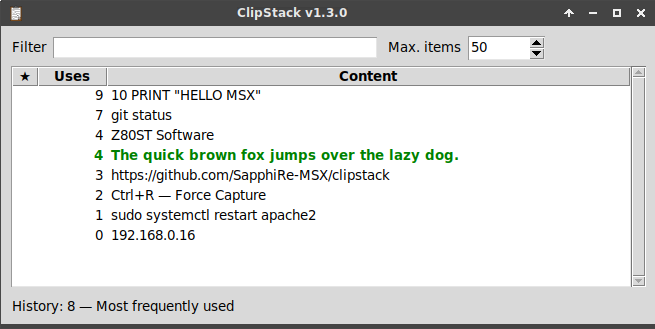

# ClipStack
 
ClipStack is a lightweight clipboard history manager focused on speed, simplicity and keyboard-driven workflows.

It continuously monitors the system clipboard, stores a configurable history of text clips, and provides fast access through real-time filtering. Frequently used clips can be pinned to prevent automatic removal, and the complete history can be imported or exported for reuse.

ClipStack is designed to stay out of the way: it can run from the system tray when available, or provide the same functionality through its window menu on desktop environments without tray menu support.

Clipboard monitoring is transparent and does not interfere with normal copy and paste operations. Automatic history management never modifies the system clipboard; only explicit user actions, such as copying or deleting a stored clip, may change its contents.

## Features

- Clipboard history.
- Manually force clipboard capture, even when its contents have not changed.
- Filter as you type.
- Pin frequently used entries.
- Sort the history by most recently copied (MRC) or most frequently used (MFU).
- Track how often clips are reused from ClipStack.
- Manually promote entries to the top of the history in MRC mode.
- Edit stored clips.
- Import and export clipboard history.
- Automatic persistence.
- System tray integration.
- Window menu fallback for desktops without tray support.
- Adjustable UI scale (100%–200%).
- Multilingual interface.
- Manual update checking through GitHub.

## Compatibility

| Platform | Status | Notes |
|----------|:------:|-------|
| Linux (X11) | ✅ | Fully supported, including system tray integration. |
| Linux (Wayland) | ⚠️ | Works, but clipboard behavior may vary depending on the desktop environment. |
| Windows | ✅ | Fully functional with `--no-tray`. |
| macOS | ❓ | Not tested. |

## Screenshots

### Most recently copied (MRC)

The following screenshots show the same clipboard history in the two available sorting modes.



### Most frequently used (MFU)



## Requirements

ClipStack requires **Python 3** and the following libraries:

* **tkinter** (usually included with Python, although some Linux distributions provide it as a separate package).
* **pystray** for system tray integration.
* **Pillow** for system tray icon support.

The required Python packages can be installed with:

```bash
pip install pystray pillow
```

On Debian/Ubuntu-based Linux distributions, install tkinter with:

```bash
sudo apt install python3-tk
```

On other operating systems, install tkinter using the appropriate Python distribution or system package manager.

## Launching the application

Start ClipStack from a terminal with:

```bash
python3 clipstack.py
```

By default, ClipStack uses the system tray when it is available.

The optional `--no-tray` parameter disables tray integration and enables the application window menu instead:

```bash
python3 clipstack.py --no-tray
```

Use this option on desktop environments that do not support tray menus, or if you prefer to access all commands from the application window.

## Data storage

On its first execution, ClipStack automatically creates the file `.clipstack_history.json` in the user's home directory. No manual setup is required.

Clipboard history and application settings are saved automatically whenever they change, preserving pinned items, timestamps, usage counters and user preferences (including the sorting mode) between sessions.

The **Export** and **Import** commands allow the clipboard history to be saved to or restored from an external JSON file. Exported files contain only the clipboard history (including pinned items, timestamps and usage counters); application settings are not exported.

## History list

ClipStack offers two sorting modes:

- **Most recently copied (MRC):** displays clips in their stored history order, with newly captured or recaptured text at the top. Manual promotions and edits can also change this order.
- **Most frequently used (MFU):** displays clips by the number of times they have been copied **from ClipStack**, from highest to lowest. Ties retain the stored MRC order. Automatic clipboard captures do not increase usage counters.

When the history exceeds its configured maximum size, ClipStack automatically removes the last unpinned entry according to the active sorting mode. In MRC mode, this is the least recently copied entry; in MFU mode, it is the least frequently used entry, with MRC order breaking ties.

Pinned entries are never removed automatically. Unpinning an entry removes this protection, so the entry may be immediately discarded if the history is already over its configured limit. If a newly captured clip is immediately discarded because of the history limit, its contents remain available in the system clipboard.

Each entry shows:

- A ★ icon for pinned items.
- A usage counter in MFU mode.
- An optional timestamp.
- A one-line preview of the clipboard contents.

The preview remains the last column, while the usage counter is shown only in MFU mode. The status line indicates the active sorting mode.

The entry currently stored in the system clipboard is normally highlighted in green and bold.

## Clipboard entry menu

Each clipboard entry provides its own context menu, available by right-clicking the item. Most actions are also available through their associated keyboard shortcuts. Double-clicking an item copies it to the system clipboard. Rapid sequences of clicks produce a single copy operation. If the **Hide when copy** option is enabled in the Configuration menu, the application window is also hidden.

Clicking the **pin** column toggles the pinned state of an item without opening the context menu.

### Copy / Copy and hide *(Enter)*
  Copy the selected item to the system clipboard and increment its usage counter.

### Pin / Unpin *(F2)*  
  Pin or unpin the selected item.

### Promote to top *(Ctrl+Home)*
  Move the selected item to the top of the clipboard history. Available only in MRC mode and disabled when the item is already at the top.

### Edit *(Ctrl+E)*  
  Edit the selected item text. The pin state and usage counter are preserved. If editing merges two entries with identical text, their usage counters are added together, and the result remains pinned if either entry was pinned.

### Delete *(Del)*  
  Remove the selected item.

The **Copy** entry changes to **Copy and hide** when the **Hide when copy** option is enabled in the Configuration menu.

## Main menu

The first two entries are only available from the system tray menu. When ClipStack is started with `--no-tray`, or when the desktop environment does not provide tray menus, the application remains accessible through the application window menu instead.

### Show

Restore the ClipStack window.

### Hide *(Esc)*

Hide the window while keeping ClipStack running in the background.

The remaining menu entries are available from both the system tray menu and the application window menu.

### File

- **Force Capture** *(Ctrl+R)*  
  Manually capture the current clipboard contents, even if the text has not changed since the last check. This allows restoring text that is still in the system clipboard but no longer appears in the history, for example after editing an entry. Force Capture does not modify the clipboard or increment usage counters.

- **Import** *(Ctrl+L)*  
  Load clipboard history from an external file.

- **Export** *(Ctrl+S)*  
  Save the current clipboard history to an external file.

### Clear

- **Unpinned** *(Ctrl+Shift+U)*  
  Remove all unpinned items.

- **All** *(Ctrl+Shift+A)*  
  Remove all items.

- **Not matching filter** *(Ctrl+Shift+N)*  
  When a filter is active, remove all items that do not match it.

### Configuration

- **Autocapture**  
  Enable or disable automatic clipboard monitoring.

- **Show timestamp** *(Ctrl+T)*  
  Show or hide timestamps in the history list.

- **Hide when copy** *(F6)*  
  Automatically hide the window after copying an item to the clipboard (tray mode only).

- **Sort by** *(Ctrl+M)*  
  Choose **Most recently copied** (MRC) or **Most frequently used** (MFU). The selected mode is saved between sessions. `Ctrl+M` switches between the two modes when the application window has focus.

- **Window position**  
  Select the screen corner where the window is displayed.

- **UI scale**  
  Adjust the interface scale (100%, 125%, 150%, 175% or 200%). ClipStack automatically restarts to apply the new scale.

- **Language**  
  Select the application language.

### About

Display the current ClipStack version and check manually whether a newer release is available on GitHub.

### Exit

Exit the application.

## Keyboard shortcuts

| Shortcut | Action |
|----------|--------|
| Enter | Copy the selected item |
| Del | Delete the selected item |
| Esc | Hide the window *(tray mode only)* |
| F2 | Pin / Unpin the selected item |
| F6 | Toggle **Hide when copy** |
| Ctrl+Home | Move the selected item to the top *(MRC mode only)* |
| Ctrl+E | Edit the selected item |
| Ctrl+L | Import clipboard history |
| Ctrl+M | Toggle MRC / MFU sorting |
| Ctrl+R | Force Capture the current clipboard contents |
| Ctrl+S | Export clipboard history |
| Ctrl+T | Show / Hide timestamps |
| Ctrl+Shift+A | Clear all items |
| Ctrl+Shift+N | Clear items not matching the current filter |
| Ctrl+Shift+U | Clear unpinned items |

## Localization

ClipStack currently supports English and Spanish.

The localization system is designed to be easily extended. Contributions adding support for additional languages are always welcome.

## Limitations

- Only text clipboard entries are stored. Images and other clipboard formats are ignored.
- Automatic clipboard monitoring detects changes in clipboard contents, not individual copy operations. Copying identical text again may therefore go undetected. Use **Force Capture** *(Ctrl+R)* to manually capture the current clipboard contents.
- Clipboard monitoring is limited to the local user session.
- Clipboard contents copied from ClipStack may not persist after closing the application, depending on the desktop environment and clipboard backend.

## Acknowledgements

Thanks to everyone who tested ClipStack and provided feedback, bug reports and feature suggestions.

Special thanks to my daughter, Pink Scratchy 314, for designing the ClipStack icon.

## License

ClipStack is free software released under the GNU General Public License v3.0 (GPL-3.0). See the `LICENSE` file for the complete license text.
